# OpenCode Go reasoning effort — device verification evidence

**Date:** 2026-11-14
**Branch:** `feat/opencode-go-reasoning-effort`
**Base:** `fork/main` (`7ec0331`)
**Code tested:** `e9cef64` (`feat: select reasoning effort from the chat composer`)
**Device:** Xiaomi `2312DRA50G` (`garnet`, Redmi Note 13 Pro 5G), Android 15
**Build:** `app-online-debug.apk` from the tested code, installed with
`adb install -r` (same debug signature; app data and saved key preserved)
**Provider:** OpenCode Go · `deepseek-v4.1-flash`

The API key was already in the Android Keystore vault. It was never read,
printed, copied to this document, or committed. `run-as` was used only to read
the generated `settings.yaml` and the Claude Code process environment.

---

## 1. Result summary

| # | Test | Result | Evidence |
|---|---|---|---|
| 1 | Agent screen exposes effort for OpenCode Go | **PASS** | `Bajo / Alto / Máximo`; `Alto` selected; no other provider shows it |
| 2 | Chat composer exposes the current effort | **PASS** | `Esfuerzo de razonamiento Alto` chip above the input |
| 3 | Chat chip opens the model's level list | **PASS** | Menu shows `Bajo`, `Alto` (checked), `Máximo` |
| 4 | Selecting `Máximo` in chat updates the UI immediately | **PASS** | Chip changes to `Máximo` before sending |
| 5 | DSH turn uses `Máximo` | **PASS** | “Responde solo OK” → `OK` (16 s); `settings.yaml` has `reasoningEffort: 'max'` |
| 6 | Effort persists across leaving and reopening the chat | **PASS** | Reopened chat still shows `Máximo` |
| 7 | Chat selection syncs to the Agent screen | **PASS** | Agent screen shows `Máximo` selected |
| 8 | Claude Code receives the selected effort | **PASS** | Chat `Máximo`; “Responde OK” → `OK` (13 s); env `CLAUDE_CODE_EFFORT_LEVEL=max` |
| 9 | No credential in `settings.yaml` | **PASS** | `grep -c oc_sk_` → `0`; only `apiKeyEnv: MH_DSH_API_KEY` |
| 10 | No crash during the device session | **PASS** | Logcat: no `FATAL EXCEPTION` for `com.jarves.mh` |
| 11 | Restored profiles and runtime to `Alto` | **PASS** | Both agents show `Alto`; final DSH turn wrote `reasoningEffort: 'high'` |
| 12 | Internationalization | **PASS** | 7 locales have every new key; Arabic RTL and Greek LTR rendered on device |

The selector is intentionally limited to `OPENCODE_GO`; other providers keep
their existing behavior.

---

## 2. Screenshots

### 2.1 Agent screen — effort selector for OpenCode Go

OpenCode Go, fixed endpoint, `deepseek-v4.1-flash`, active credential, and the
three levels advertised by the model.

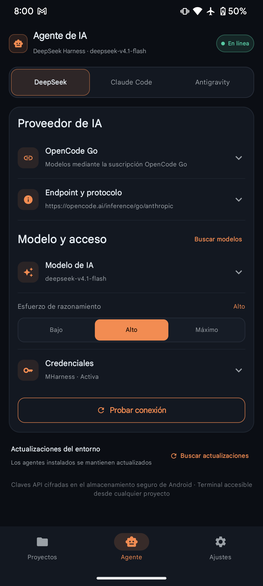

### 2.2 Chat composer — current effort

The chip sits above the message input and shows the active level.

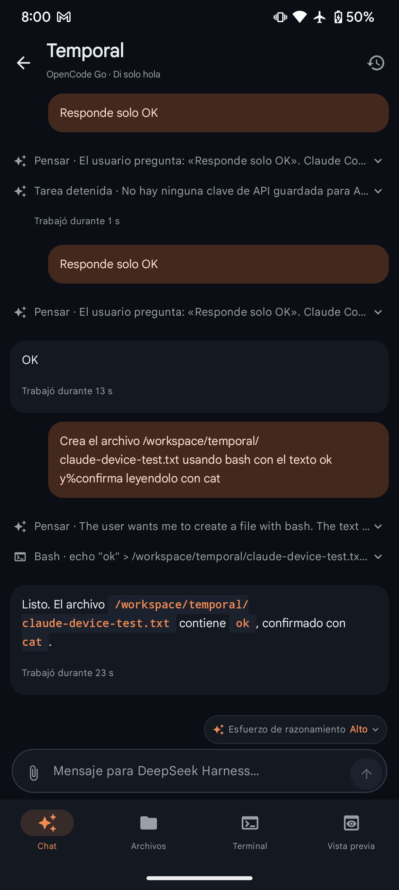

### 2.3 Chat composer — level menu

The menu offers only the levels reported for the selected model.

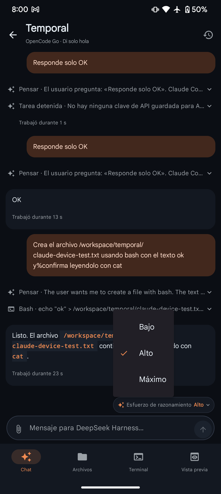

### 2.4 Chat composer — Máximo selected

The selection is applied and persisted immediately, without opening the Agent
screen or running **Test connection**.

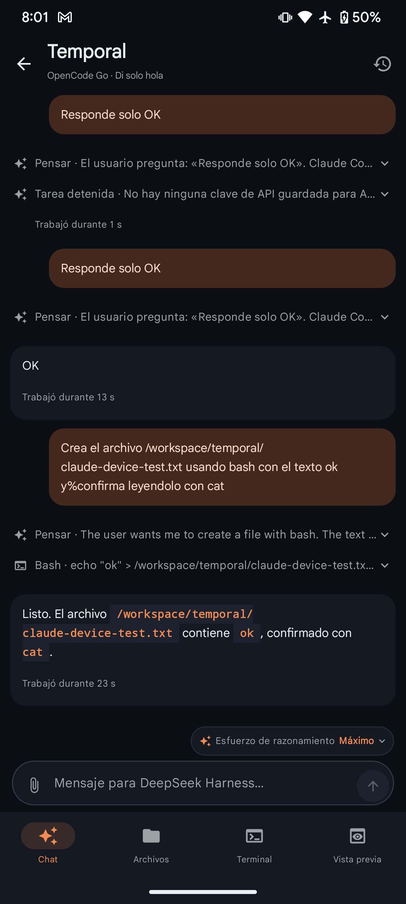

### 2.5 DSH response with Máximo

A short prompt keeps Go quota use minimal. The turn completed with the effort
chip still showing `Máximo`.


### 2.6 Persistence after reopening the chat

Leaving the workspace and reopening the project keeps `Máximo` selected.

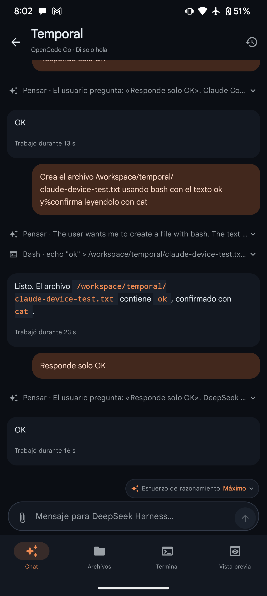

### 2.7 Agent screen synchronized from the chat

The provider profile is the source of truth, so the Agent screen reflects the
chat selection.

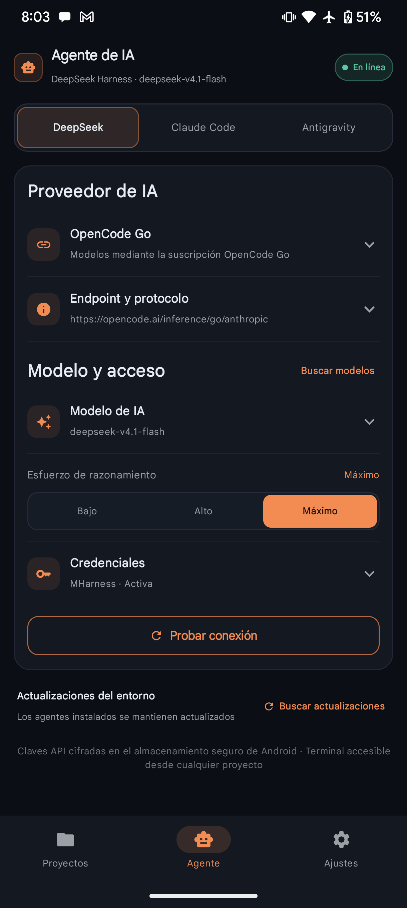

### 2.8 Claude Code with Máximo

Claude Code answered with the same provider/model and the chip set to `Máximo`.

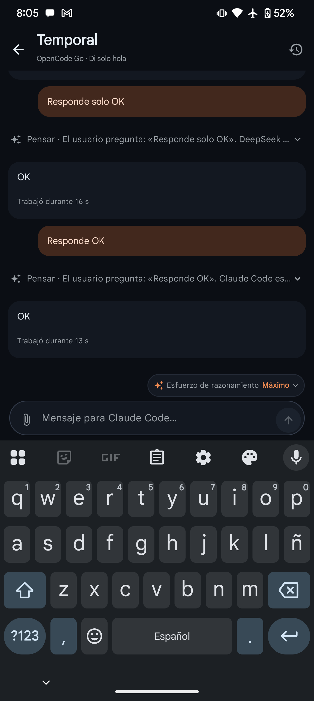

### 2.9 Restored state — Claude Code

Claude Code was returned to `Alto`.

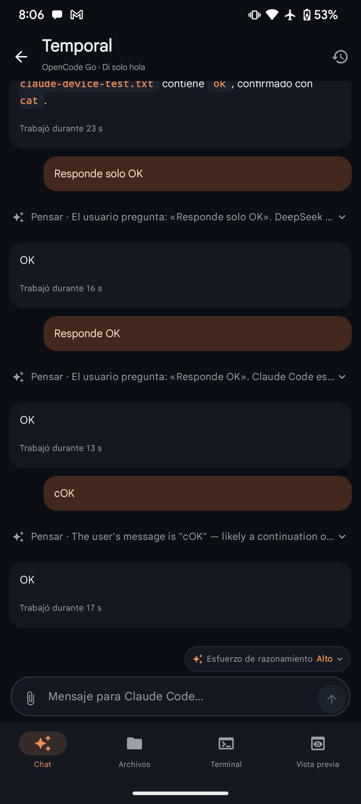

### 2.10 Restored state — DeepSeek Harness

DeepSeek Harness was also returned to `Alto`. A final short turn completed and
rewrote `settings.yaml` with `reasoningEffort: 'high'`, so the runtime matches
the saved profile.

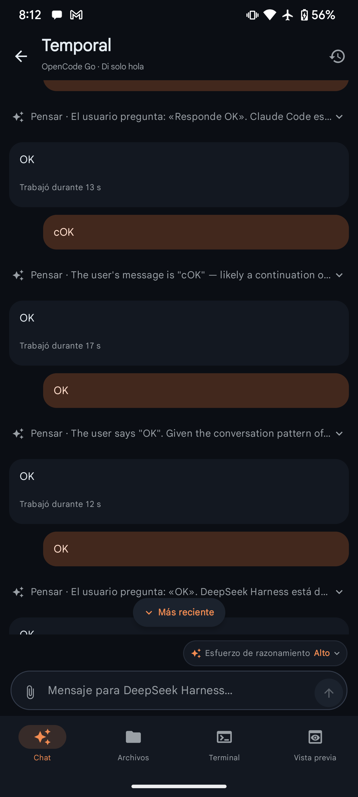

### 2.11 Arabic (RTL) — Agent selector

The selector mirrors correctly: `مستوى الاستدلال` with `منخفض / عالٍ / أقصى`.

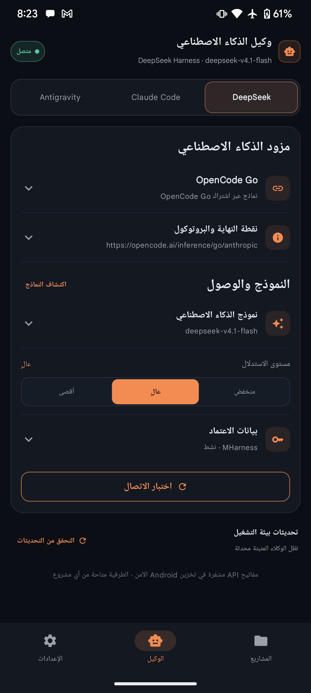

### 2.12 Arabic (RTL) — chat chip and menu

The chip and dropdown mirror and use the Arabic labels.

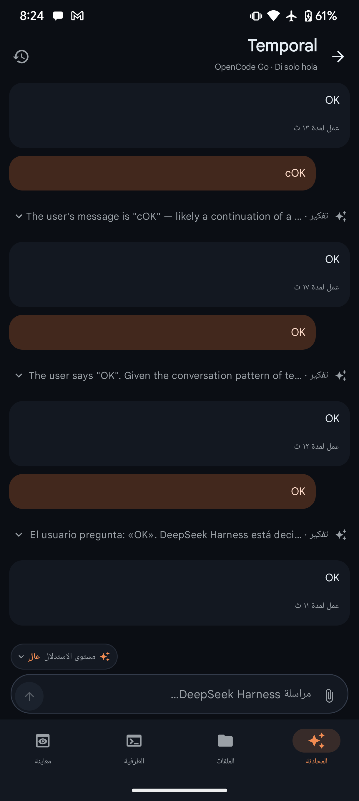

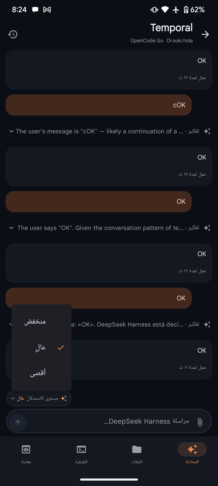

### 2.13 Greek (LTR, long labels) — Agent and chat

Greek exercises the longest LTR labels; both the selector and the chat chip fit
without clipping.

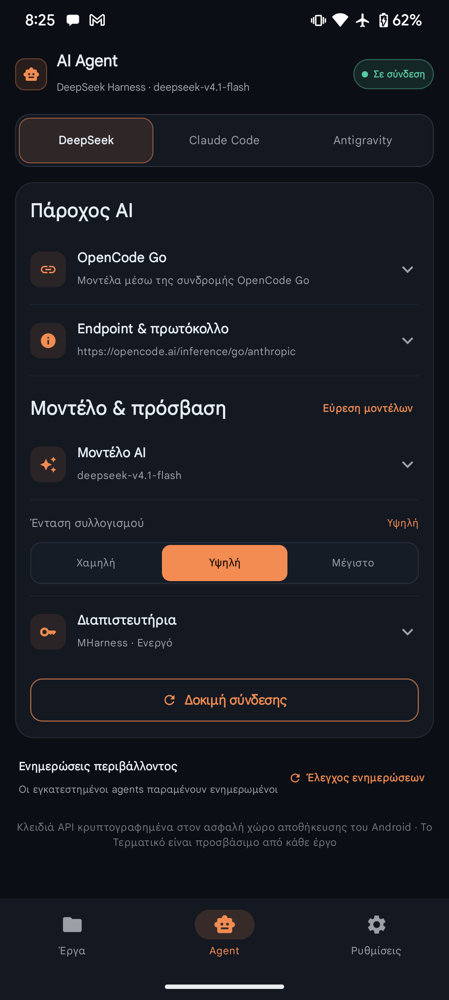

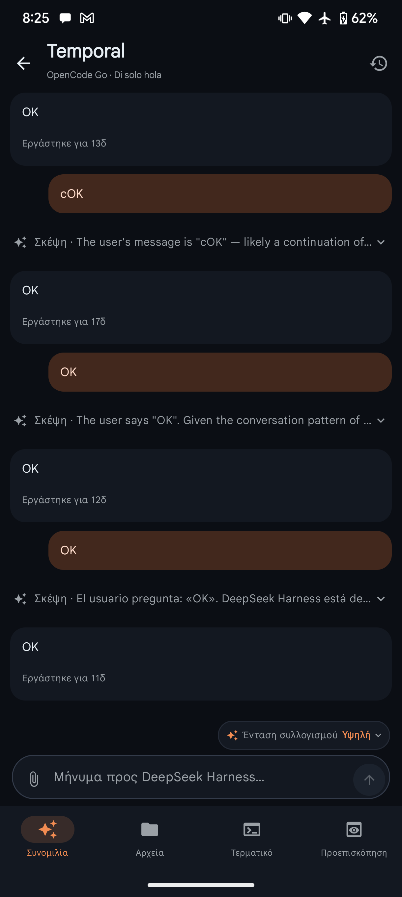

---

## 3. Runtime evidence

### 3.1 `settings.yaml` written for DSH

The real file in the PRoot rootfs changed from the pre-feature shape to:

```yaml
agent-default-model:
  provider: opencode-go
  model: 'deepseek-v4.1-flash'
  reasoningEffort: 'max'
llm-pi-ai:
  providers:
    opencode-go:
      apiKeyEnv: MH_DSH_API_KEY
      api: anthropic-messages
      baseURL: 'https://opencode.ai/inference/go/anthropic'
      compat:
        forceAdaptiveThinking: true
      headers:
        x-opencode-session: 'ses_<redacted>'
      models:
        - id: 'deepseek-v4.1-flash'
          reasoningEfforts:
            low: 'low'
            high: 'high'
            max: 'max'
```

The key remains only in the process environment (`MH_DSH_API_KEY`).

After restoring the chat to `Alto` and sending one short DSH turn, the same file
was rewritten to:

```yaml
agent-default-model:
  provider: opencode-go
  model: 'deepseek-v4.1-flash'
  reasoningEffort: 'high'
```

This confirms the selector changes the runtime in both directions, not only on
the first save.

### 3.2 Claude Code process environment

While the Claude Code turn was running:

```text
PID=7363
ANTHROPIC_MODEL=deepseek-v4.1-flash
CLAUDE_CODE_EFFORT_LEVEL=max
```

This confirms the chat selection reaches the Claude Code launch environment, not
only the DSH YAML.

### 3.3 Logcat and secrets

```text
0 oc_sk_ in settings.yaml
0 FATAL EXCEPTION for com.jarves.mh
```

The screenshots contain no API key. The evidence session did not read
`pocket_secrets.xml` and did not decrypt the vault.

---

## 4. Static gates

Run from the tested code `e9cef64`:

```text
:app:testOnlineDebugUnitTest --rerun-tasks   → BUILD SUCCESSFUL, 262 tests, 0 failures
:app:lintOnlineDebug --rerun-tasks           → 0 errors, 144 warnings, 1 hint
:app:assembleOnlineDebug --rerun-tasks       → BUILD SUCCESSFUL
```

Relevant tests:

- `ReasoningEffortTest` — normalization, fallback, chat-selection transition.
- `ModelResponseParserTest` — reads `capabilities.reasoning.effort`.
- `DshSettingsBuilderTest.openCodeGoWritesSelectedReasoningEffortAndAdaptiveCompat`
- `DshSettingsBuilderTest.chatSelectedEffortReachesDshSettings`
- `RuntimeLaunchConfigBuilderTest.openCodeGoSetsClaudeCodeEffortLevel`
- `RuntimeLaunchConfigBuilderTest.chatSelectedEffortReachesClaudeCode`

### 4.1 Localization check

Every registered locale contains exactly one copy of the new keys:

```text
values       (English)   st_reasoning_effort, st_effort_minimal, st_effort_low,
                         st_effort_medium, st_effort_high, st_effort_xhigh, st_effort_max
values-es    (Spanish)   same keys
values-ar    (Arabic)    same keys
values-el    (Greek)     same keys
values-hi    (Hindi)     same keys
values-ru    (Russian)   same keys
values-zh    (Chinese)   same keys
```

The new UI uses `stringResource(...)` for every label; only model IDs and
provider names remain English by design. Arabic (RTL) and Greek (long LTR) were
also rendered on device; see screenshots 11–15.

---

## 5. Notes

1. The chat control is shown only for `OPENCODE_GO` models with a non-empty
   effort list. `none`/unknown catalog values are ignored; DeepSeek V4.1 Flash
   offers `low`, `high`, and `max`.
2. The chat selection saves immediately. The Agent screen still saves on
   **Test connection**, which is the existing behavior for model/provider edits.
3. A running turn keeps the effort it started with. The next turn, and a manual
   retry that is still pending, use the newly selected level.
4. The Claude Code test used the same Go key and model. No separate credential
   was created.
5. The test did not modify `OPENCODE_ZEN`, Antigravity, or the recovery
   contract.
6. The feature is localized in all seven registered locales. The device was
   checked in Spanish (LTR), Arabic (RTL), and Greek (long LTR); the app was
   returned to Spanish after testing.
